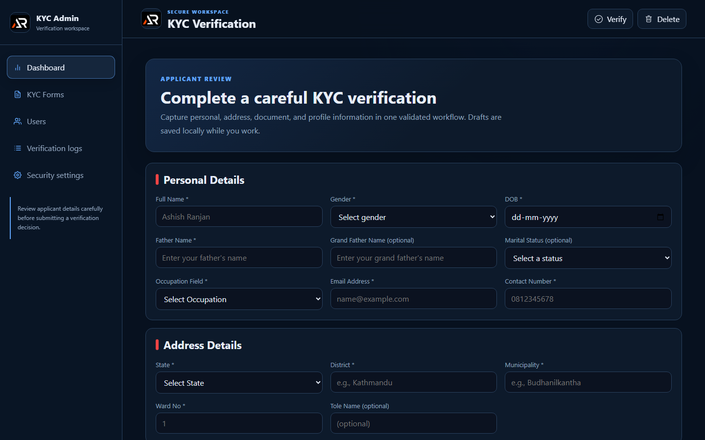

# KYC Verification

A responsive front-end demo of a KYC form workflow built with React. It demonstrates client-side validation and a profile photo preview only; it does not submit, save, or verify identity information. Use fictional details only.

## Features

- Personal, address, document, and profile photo sections
- React Hook Form and Yup validation
- Dynamic document number label based on document type
- No browser draft storage or backend submission
- Image preview and clear action
- Demo validation, reset, and toast feedback actions
- Responsive fixed navigation, mobile menu, social sharing metadata, and go-to-top control

## Tech Stack

- React and Vite
- styled-components
- React Hook Form, Yup, and React Toastify
- react-icons

## Run Locally

~~~bash
npm install
npm run dev
~~~

Build and preview the production version:

~~~bash
npm run build
npm run preview
~~~

Live demo: https://a2rp.github.io/kyc-verification/

Do not enter real personal or identity information. Form data stays in the current page state only. The demo does not transmit information or perform identity checks.

For privacy, the app also removes the legacy `kyc_form_draft_v2` localStorage entry left by earlier versions when that entry exists.

## Future Direction

The current version has no backend. A real KYC service would need a secure server-side workflow, identity and consent notices, access controls, retention rules, and appropriate review before handling real applicant data.

## Links

- Portfolio: [https://www.ashishranjan.net/](https://www.ashishranjan.net/)
- GitHub: [https://github.com/a2rp](https://github.com/a2rp)
- CodePen: [https://codepen.io/ash1198](https://codepen.io/ash1198)
- LinkedIn: [https://www.linkedin.com/in/aashishranjan](https://www.linkedin.com/in/aashishranjan)
- Facebook: [https://www.facebook.com/theash.ashish/](https://www.facebook.com/theash.ashish/)
- YouTube: [https://www.youtube.com/@ashishranjan-ashz?sub_confirmation=1](https://www.youtube.com/@ashishranjan-ashz?sub_confirmation=1)
- Email: [ash.ranjan09@gmail.com](mailto:ash.ranjan09@gmail.com)

## Support

- Support: [https://a2rp-donation-page.netlify.app/](https://a2rp-donation-page.netlify.app/)
- Buy Me a Coffee: [https://buymeacoffee.com/a2rp](https://buymeacoffee.com/a2rp)
- Patreon: [https://patreon.com/a2rp](https://patreon.com/a2rp)
